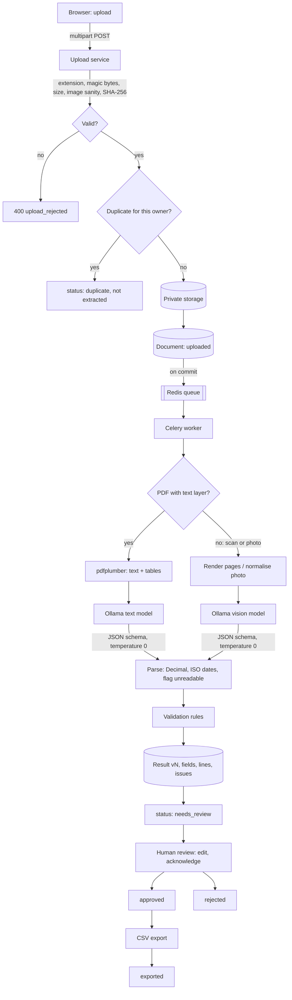

# Architecture

## Processing flow



Failures (timeouts, malformed output) retry with exponential backoff; after the last
attempt, or immediately for permanent errors (no model configured, encrypted PDF, too
many pages), the document goes to `failed` with an operator-readable reason.

## Layers

| Layer | Location | Rule |
|---|---|---|
| Views | `api/views.py`, `ui/views.py` | Parse input, call one service, return JSON (API) or HTML (UI). No logic. |
| Services | `services/` | All business logic and transactions. |
| Validators | `validators/` | Pure Python, no Django; typed inputs, typed `Issue` outputs. |
| Extraction | `extraction/` | Routing, PDF/image reading, schemas, prompts, parsing. |
| Providers | `providers/` | `ExtractionProvider` interface; `OllamaProvider` is one implementation. |

## Status lifecycle

```
uploaded → processing → needs_review → approved → exported
               └→ failed      ├→ rejected
                              ├→ needs_clarification ⇄ needs_review
                              └→ duplicate
reprocess: needs_review | failed | duplicate | needs_clarification → uploaded
```

Transitions are explicit (`services/lifecycle.py`), lock the row, and write an audit
entry. Illegal transitions raise `InvalidTransition` (HTTP 409). `approved` is reachable
only from `needs_review` through `approve()`.

## Data model

- `Document`: file metadata, SHA-256, type, status, method, owner/request references,
  soft-delete and `retain_until`.
- `ExtractionResult`: one per run, versioned (`version` increments, history kept), raw
  text, model JSON, model name, provider, prompt version, duration.
- `ExtractedField` / `ExtractedLine`: reviewable values with status and reason. Money is
  `DECIMAL(14,2)`. Lines are soft-deleted.
- `ValidationIssue`: rule code, severity, field or line, message, resolved by whom.
- `AuditLog`: append-only (ORM guard and a PostgreSQL trigger that rejects UPDATE/DELETE).

## The pages (HTMX)

The UI in `ui/` does not call the JSON API. It is plain Django views and templates:

| User does | htmx sends | Server answers |
|---|---|---|
| Types in a filter, sorts, pages | `GET /intake/?search=…` with `HX-Request` | only `partials/documents_table.html` |
| A file is processing | the table repeats its own GET every 4 s | the table again; once nothing is processing it has no polling trigger, so polling stops |
| Uploads files | `POST /intake/upload/` (multipart) | one line per file + `HX-Trigger: documents-changed`, which reloads the table |
| Edits a field or cell, adds/removes a row, acknowledges an issue | `POST …/fields/<id>/` etc. on `change` | `partials/review_body.html` re-rendered and re-validated (totals computed in Python) |
| Approves, rejects, asks the client, reprocesses | `POST …/approve/` (text via `hx-prompt`) | `HX-Refresh: true` (page reloads) or an error in `#messages` |

`base.html` sets the CSRF header for every htmx request (`hx-headers`) and configures htmx
for the strict CSP: no injected styles, no `eval`, no page snapshots in `localStorage`.

## Why these choices

- **Text-layer PDFs skip the vision model**: exact text from pdfplumber is cheaper and
  more reliable than reading pixels; the model only structures it.
- **Statuses from evidence, not model confidence**: local models give no calibrated
  confidence, so each field is `ok`, `warning`, `error` or `missing` based on parsing and
  accounting rules.
- **Server-rendered page images for preview**: one viewer for PDFs and photos without a
  third-party PDF library in the browser.
- **Size guards fail loudly** (`MAX_PAGES`, `MAX_VISION_PAGES`, `MAX_TEXT_CHARS`):
  truncating a statement silently would drop transactions.
